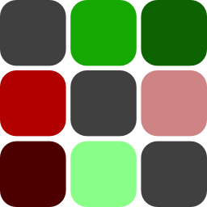
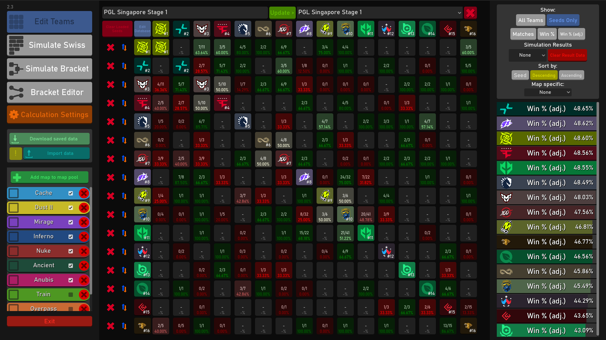
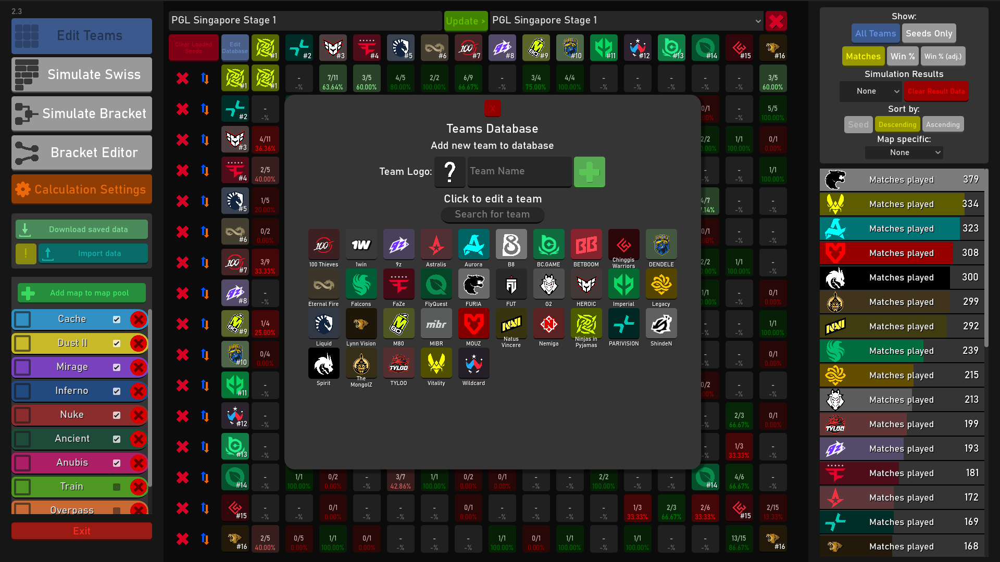
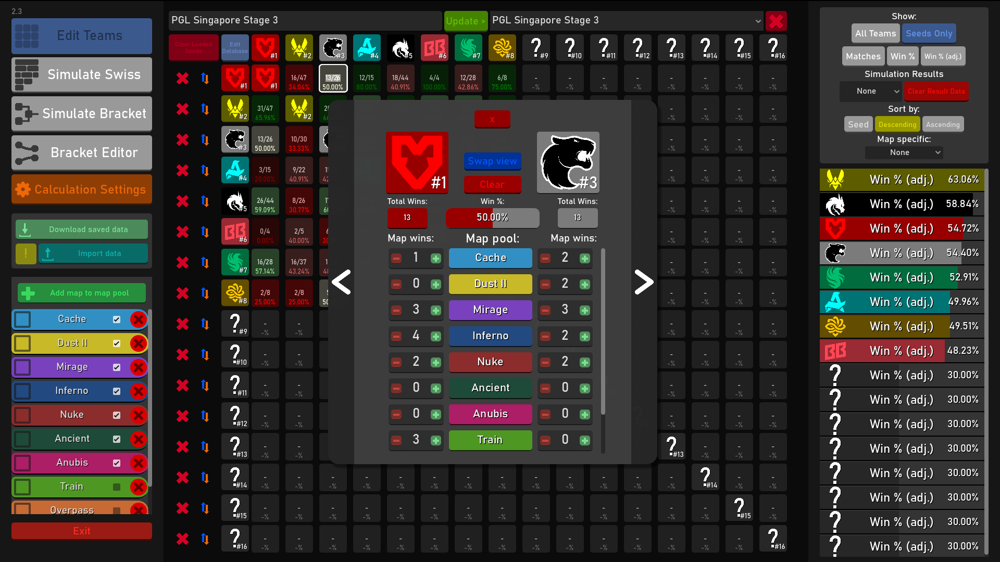
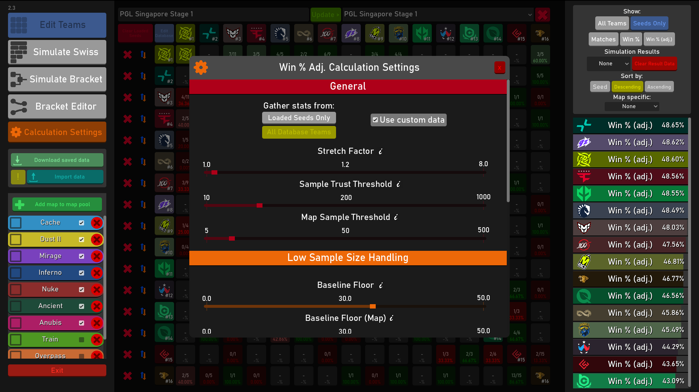
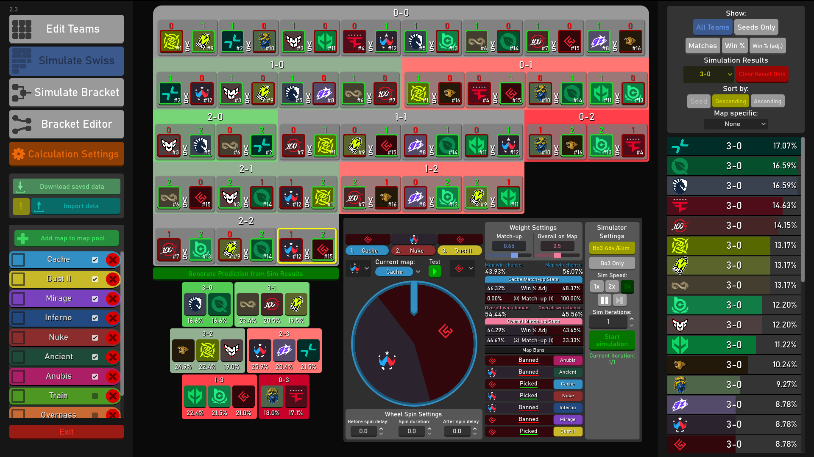
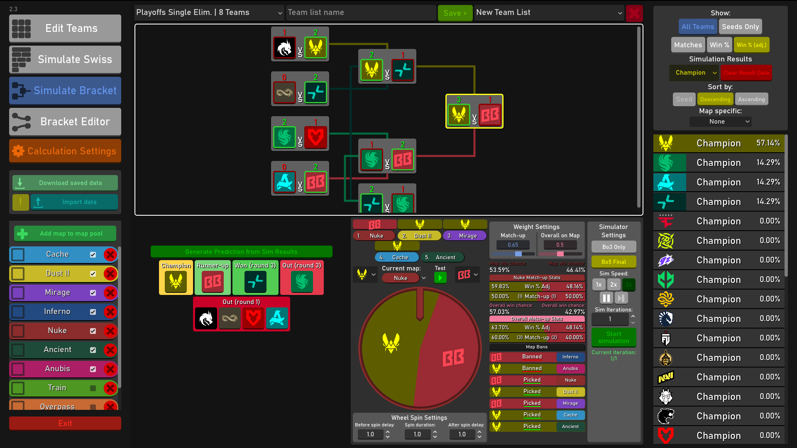

# Swiss Auto Simulator

## About this project:

This was created as a way to make predictions for the Counter-Strike 2 Major Pick Ems. Previously, it only followed the games current format of Swiss as seen [here](https://github.com/ValveSoftware/counter-strike_rules_and_regs/blob/main/major-supplemental-rulebook.md). As of version 2.3, there is now a bracket editor that will allow for support for other tournament formats. 

It utilizes the head-to-head data between cores (at least 3 players of a team) to calculate a customizable win percent value. It also contains specific win percent values for each map in the map pool. These values are used in the simulation to determine the odds of one team winning over another. This result will be used across the entire bracket. The bracket can be simulated many times in succession, with a tallying system that allow you to view the results of any number of simulations. Based on these results, a sorted list of the most likely outcomes for each end result (3-0, 2-3, 1-3, etc.) can be generated. 

There is plenty of customizability within the project to allow you to tweak the calculated values, or use your own custom values. In no way is this project meant to be a perfect predictor, as many more factors go into the real results than the data being used. The best use case is not to take the results at face value, but rather to detect a pattern or to give you more insight into the teams, and likely bracket formations.

The project has an updating database of teams that are attending HLTV MVP events. New teams will be added overtime, and new results will be reflected in the existing team head to heads. All of the data is being manually added by me, since there isn't a way to ethically scrape the data from anywhere (that I am aware of). I will be using [HLTV](https://hltv.org) to get all of my data, and will do my best to ensure accuracy in my collection. You have to ability to add your own teams and results as well though, so it will always be possible to maintain the data yourself. 

There is a downloadable exe version [here](https://github.com/elijahlflowers/Swiss-Auto-Simulator/releases) or you can access the web version of the project [here](https://elijahlflowers.github.io/Swiss-Auto-Simulator/)

You can also find some other related tools I've created at [cs2ools.blue](https://cs2ools.blue/)
## Screenshots
### Edit Teams

### Teams Database

### Map Stats Editor

### Calculation Settings

### Swiss Simulator

### Bracket Simulator

### Bracket Editor
![[BracketEditor.png|Playoffs]]
